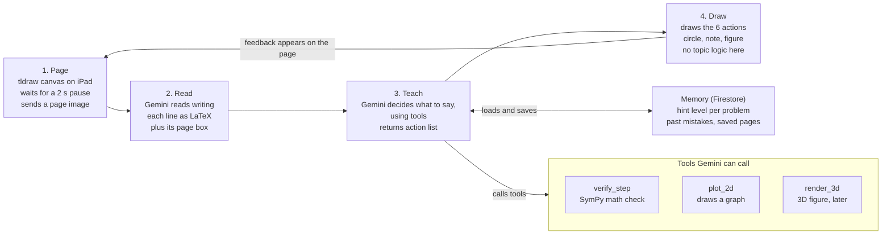

# AI Tutor Notebook: DevFest Build Plan

Nov 14, 2026 · Preet + Parsh

## The idea

A notebook on the iPad that watches you work problems by hand and teaches you like a tutor sitting next to you. It finds your mistakes, gives hints instead of answers, and draws graphs and figures right on the page. Track: **Best Integration of Gemini/Google API**.

**How it feels to use:**

1. You write `f(x) = 3x^2 + 2x`, then `f'(x) = 6x + 1`.
2. You pause. A red circle appears around `+ 1` with a small note: "What happens to the x in 2x when you take the derivative?"
3. Stuck on a new problem, you circle it and tap Help. Hint 1 is a nudge, hint 2 is a bigger push, and only hint 3 shows the worked step.
4. You write "graph this" next to a function, and a graph appears beside it. Later: 3D figures you can spin, Loomin style.

**Build order:** basic calculus and algebra first, then the engineering notebook (circuits, block diagrams) once the core works.

**Name:** [need: name]

## Structure

The app is split so Gemini does all the thinking and the code only draws. That's how we avoid hard-coding: no if-statements per math topic, no canned feedback, no templates.

Each pass goes left to right, and the feedback lands back on the page.

**1. Page.** The tldraw canvas in Safari. After about 2 seconds with no new strokes, it exports the page as an image and sends it, plus the page's saved state, to our server.

**2. Read.** Gemini turns the handwriting into a clean list: each line as LaTeX (the standard way to type math as text) plus a box saying where that line sits on the page. Lines get ids, so the same line isn't graded twice.

**3. Teach.** The tutor step. Gemini gets the reading, the hint level for each problem and a short teaching guide written in plain English. It decides what to do and can call tools along the way. It returns a list of actions in a fixed format.

**4. Draw.** The renderer only knows 6 actions, and works the same for calculus, circuits or anything else:

| Action | What it does |
| --- | --- |
| `circle` | Red ring around a box on the page |
| `underline` | Line under part of a line |
| `note` | Handwriting-style text next to a box |
| `figure` | Places a graph or 3D view next to a box |
| `ask` | A small "did you mean...?" bubble when the reading is unsure |
| `speak` | Says the text out loud (voice, later) |

**Why this isn't hard-coded**

- **Teaching style lives in a prompt file**, not code. Changing "give 3 hints before the answer" is a text edit.
- **New subjects are new tools, not new code paths.** Engineering mode adds a tool like `solve_circuit`; the renderer doesn't change.
- **Checks are general.** `verify_step(before, after, what_was_done)` uses SymPy to test whether two expressions match, for any algebra or calculus step.
- **Figures come from a spec, Loomin style.** Gemini writes a small description ("surface z = x² + y², range -2 to 2") and one general 3D tool draws it.

## Strong points

The biggest strength: it hits every item on the Gemini track rubric, and the demo is something a judge can hold.

- **Rubric fit.** Multimodal input (handwriting images, later voice), structured output (the action list), function calling (math checker, graph tool), and several Google services (Gemini, Firebase, Cloud Run). It literally can't exist without Gemini, which the track asks for.
- **Science fair demo.** The judge picks up the Pencil, writes a wrong derivative, and watches it get circled. Nothing else in the room will feel like that.
- **Teaching, not answer-giving.** Every other AI homework tool gives the answer. A hint ladder plus mistake finding is the opposite pitch, and professors and judges like it.
- **Trust story.** Gemini reads, a real math engine checks. When a judge asks "what if the AI is wrong?", you have an answer most teams won't.
- **Grows without rewrites.** Because the renderer only knows simple drawing actions, engineering problems and 3D figures are new tools, not a new app.
- **Your credibility.** Loomin already proves you've built AI education tools that students use. That's a story judges remember.

## Flaws and risks

The two that can sink the demo are speed and wrong feedback. Fix those before adding any feature.

| Flaw | Why it matters | Fix |
| --- | --- | --- |
| **Copy of the Zurich project** | A judge may have seen that video and ask about it. | Lead with what's new: mistake finding with a real math check, the hint ladder, engineering mode. Say it openly if asked. |
| **Slow feedback** | Each check is a round trip to Gemini with an image. Waiting a few seconds kills the magic. | Fastest Flash model, shrink the image, crop to the area that changed, show a small "thinking" pulse right away. |
| **Gemini gets math wrong** | A tutor that marks correct work as wrong is worse than nothing. | Gemini only flags; the SymPy checker confirms before a red circle is drawn. |
| **Handwriting misread** | A misread `x²` looks like a math mistake. | Show what Gemini read in small gray text. If the reading is unsure, ask "did you mean...?" instead of marking it wrong. |
| **Circles land in the wrong spot** | Boxes from Gemini can drift on a crowded page. | Ask for boxes per line, not per symbol. Pad circles a little. Test on messy pages early. |
| **Too pushy** | Interrupting mid-thought is annoying, real tutors wait. | Only check finished lines (a pause plus a new line started), and a toggle for "check as I go" vs "check when I tap". |
| **Firing on every stroke** | Wastes calls, causes flicker and repeated notes. | Only send after a real pause, skip if nothing changed, and give each line an id so the same note isn't written twice. |
| **Venue wifi** | The live demo is required to work at the table. | Phone hotspot as backup, plus the 2-minute video recorded early. |
| **Scope creep** | 3D and engineering mode are tempting and huge. | Nothing past the core loop until it works on the iPad end to end. |
| **API key exposed** | A key in browser code can be copied and drained. | Calls go through a small server route, key stays on the server. |

## Task split

Preet builds the brain (Gemini pipeline and the contract) before 4 PM, so Parsh can run with everything else on his own after that. Parsh builds the page in parallel, testing against fake Gemini replies until the real one is ready.

### Now to 4:00 PM (both)

**Preet: the brain**

- [ ] 1:45 to 2:15. Make the GitHub repo. Write `contract.ts` with the page reading shape and the 6 action types, plus 3 example replies Parsh can use as fake data. Push it.
- [ ] 2:15 to 2:45. In Google AI Studio, test the tutor instructions on photos of handwritten math (right work, wrong derivative, messy writing). Tune until the boxes and feedback look right.
- [ ] 2:45 to 3:30. Server route `/api/check`: takes the page image plus page state, calls Gemini with structured output, returns actions. Key stays on the server.
- [ ] 3:30 to 4:00. Wire it to Parsh's page, test end to end on the iPad, write the handoff notes.

**Parsh: the page**

- [ ] Vite + React app with tldraw, deployed to Firebase Hosting so the iPad opens a real link.
- [ ] Check that the Pencil writes smoothly in Safari.
- [ ] Pause detection: 2 seconds with no strokes, then export the page as a PNG (skip if nothing changed).
- [ ] Renderer: turn each action type into tldraw shapes, using the fake replies from `contract.ts`. Handwriting-style font for notes, red ellipse for circles.

### 4:00 PM to tonight (Parsh carries it)

- [ ] Math checker: a small Python service with SymPy, `verify_step` endpoint, deployed on Cloud Run. Hook it up as a Gemini tool.
- [ ] Hint ladder: the Help button, hint level saved per problem in Firestore, sent to Gemini with each request.
- [ ] Graph tool: `plot_2d` draws with function-plot and places the image next to the problem.
- [ ] Save and reload notebook pages in Firestore.
- [ ] Build a demo set: 5 problems with planted mistakes that work every time.

### Tonight (Preet back, both)

- [ ] Preet: voice (hold to ask, answers out loud with the browser's built-in speech).
- [ ] Preet: 3D figure tool with Three.js, if the core is solid.
- [ ] Both: fix whatever the demo set breaks, then polish the look and loading states.
- [ ] Preet: draft the Devpost write-up.

### Tomorrow morning

- [ ] 10:00 feature freeze, bug fixes only.
- [ ] 10:45 record the 2-minute video.
- [ ] 11:15 submit on Devpost (deadline 11:30).
- [ ] Practice the 90-second table pitch.

## 4 PM handoff and demo

Before Preet leaves, Parsh should be able to run, change and deploy everything without asking a question.

**Handoff checklist**

- [ ] Parsh can run the app locally and deploy to Firebase.
- [ ] Parsh has the Gemini key in the server's environment file (never in the repo).
- [ ] One wrong derivative gets circled on the real iPad, end to end.
- [ ] Tutor instructions live in one file (`prompts/tutor.md`) that Parsh can edit.
- [ ] Notes in the README: what works, what's next, known bugs.

**90-second table demo**

1. **Problem (15 sec):** "AI homework tools hand you the answer, so you don't learn. A real tutor watches you work and catches your mistakes."
2. **Live demo (50 sec):** write a problem with a planted mistake and it gets circled. Tap Help for a hint. Write "graph this" and a graph appears. Hand the judge the Pencil.
3. **How it works (25 sec):** Gemini reads the handwriting and decides how to teach, a math engine double-checks every step, and Firebase saves your notebook.

**Questions judges will likely ask:** What if the AI is wrong? How is this different from the Zurich project or other AI homework apps? How fast is it? Who's the user and would they pay?
