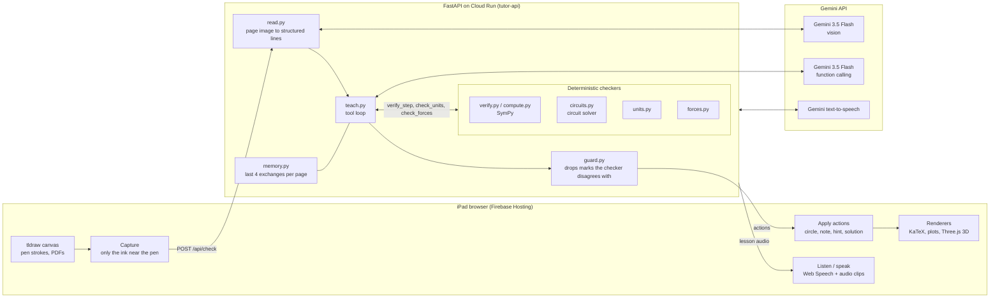
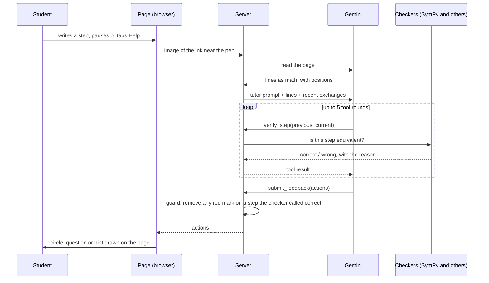
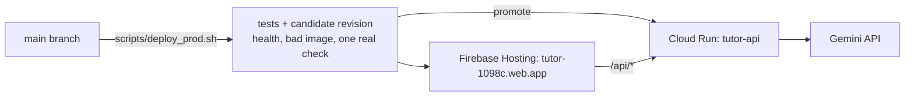
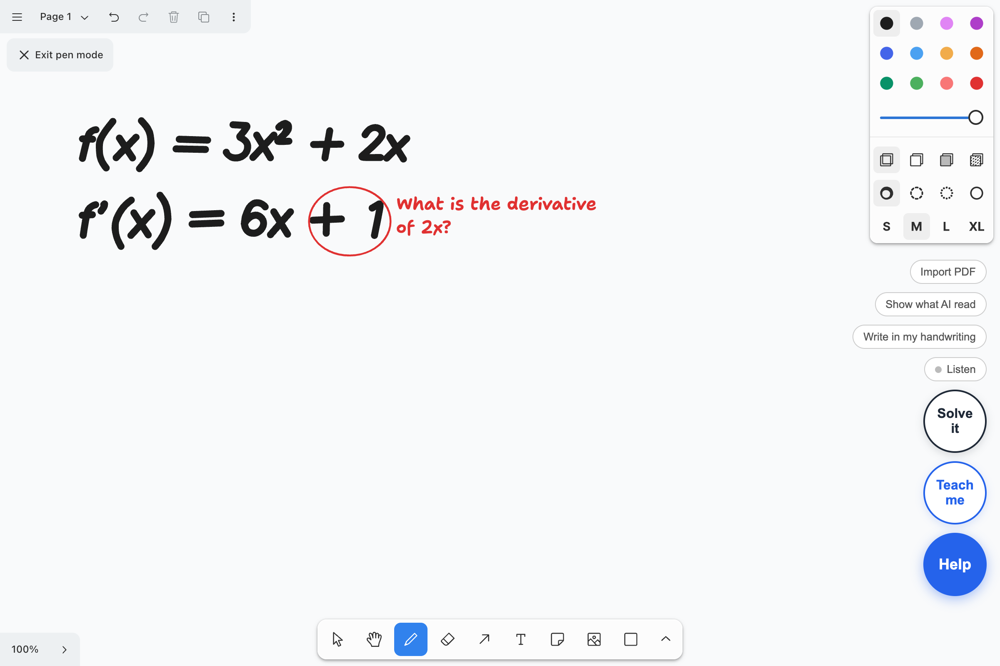
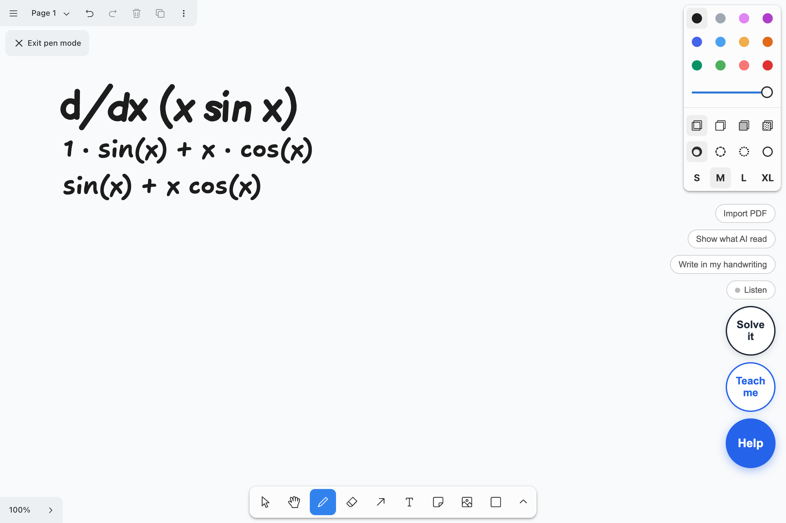
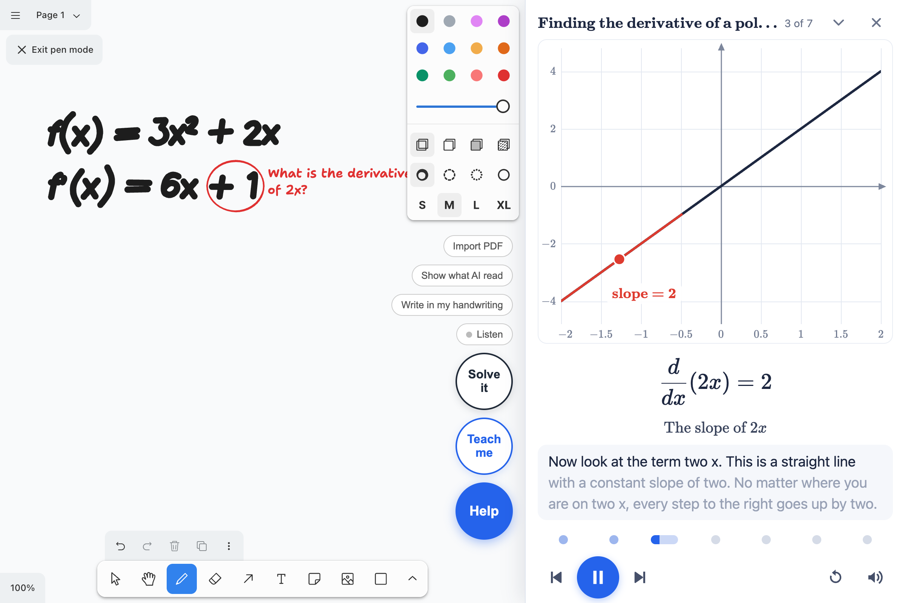
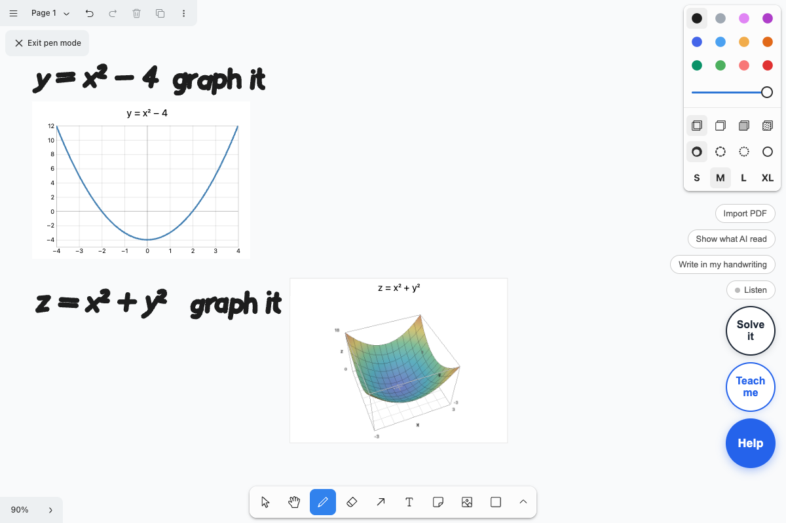
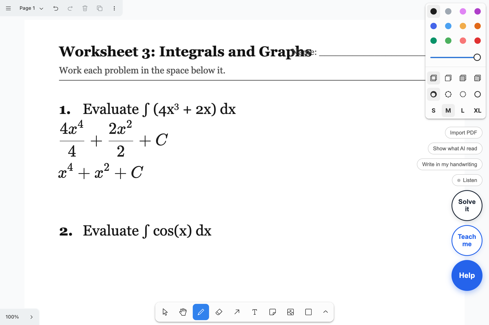
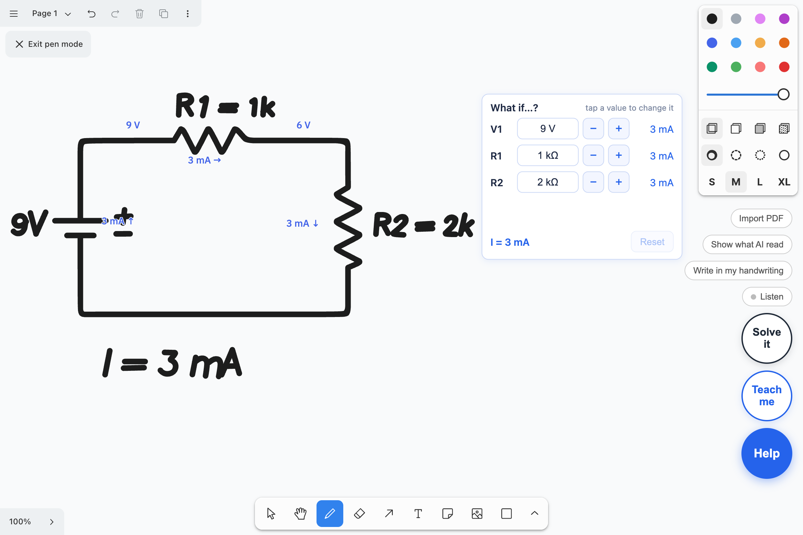

# Socra architecture

Socra is a notebook page with a tutor built in. You write math by hand, and the page marks the step that is
wrong, gives a hint, a lesson, a graph, a 3D model or a worked solution, on the same page.

The rule behind the design: **Gemini reads and explains. Code does the math.** Gemini never decides by itself
whether a step is right. It calls a checker, and the checker decides. A red mark is never a guess.

## System

## One check, step by step

One check is about 3 Gemini calls and about 21,000 input tokens. It takes 4 to 10 seconds.

## What each part does

| Part | Where | What it does |
|---|---|---|
| Canvas | `web/` (React, tldraw) | The page you write on. Imports PDFs as worksheets. |
| Capture | `web/src` | Sends only the area around the pen, not the whole page. |
| Read | `server/read.py`, `prompts/read.md` | Gemini vision turns handwriting and diagrams into structured lines. |
| Tutor loop | `server/teach.py`, `prompts/tutor.md` | Gemini calls the checkers as tools, then answers as a list of actions. |
| Math checker | `server/verify.py`, `compute.py` | SymPy checks algebra, derivatives and integrals, each step against the one before. |
| Engineering checkers | `server/circuits.py`, `units.py`, `forces.py` | Circuit solver, unit check, force balance. |
| Guard | `server/guard.py` | Removes any red mark that the checker does not support. |
| Lessons | `server/explain.py`, `practice.py` | A lesson about the mistake, then a practice problem checked the same way. |
| Solutions | `server/solution.py` | Worked steps; every step goes through the checker before it is shown. |
| Voice | `server/speak.py`, `web/src/handsfree.ts` | Gemini text-to-speech for lessons, with fallback models. Listening uses the browser. |
| Memory | `server/memory.py` | Keeps the last 4 exchanges per page so follow-ups stay on topic. |
| Graphs and 3D | `web/src/render`, `web/src/shapes` | Plots and surfaces drawn in the browser from the checked formula. 3D models from a small library or generated. |
| Circuit what-if | `POST /api/circuit/solve` | Change a value and the circuit is re-solved in code, with no AI call. |

## The contract

The server never returns free text. It returns **actions** (`contract/contract.ts`, mirrored in
`server/models.py`): circle a line, write a note, ask a question, draw a figure, write a solution, speak.
The browser draws them. This is why feedback lands on the right line of the student's own page.

## Hosting

## Handwriting

In the app today, "Write in my handwriting" finds the student's own letters on the page and replays those
pen strokes. A learned stroke model (a style encoder plus a stroke generator) is an early experiment and is
not part of the app.

## Screens

| | |
|---|---|
|  |  |
|  |  |
|  |  |
