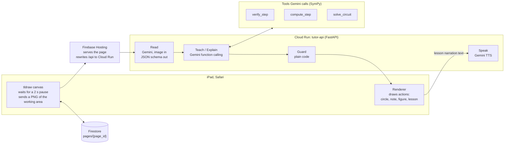

# [need: name]

Devpost page draft. Written from `AGENT_LOG.md` and the code as of 7:10 PM Saturday, Nov 14. Anything built after that is not in here yet.

Track: Best Integration of Gemini/Google API. Team: Preet and Parsh. Built at Google DevFest 2026, UC Santa Cruz, Nov 14 to 15, 2026.

Live: https://tutor-1098c.web.app

## Tagline (pick one)

1. A notebook that finds your mistake and makes you fix it.
2. Handwritten math on the iPad, checked line by line by Gemini and a real math engine.
3. Write your work by hand. Get a tutor's hint, then a lesson, and keep the answer for last.

## Inspiration

We saw a project from a hackathon in Zurich [need: project name and link] where you write a calculation by hand and the app finishes it for you. It looked great, and it is the starting point for this project. We say that to every judge.

We wanted the opposite behaviour for homework. A tutor sitting next to you does not finish your line. They point at the wrong term, ask a question, and wait for you to fix it. So we kept the handwriting canvas and changed what the AI does on it.

What is different from the Zurich project:

- It finds the mistake and asks you to fix it. It does not write the answer unless you ask.
- Gemini must call a SymPy checker on each new line. Code removes any red circle on a line the checker called correct.
- Help is a ladder of three hints. Only the third shows the worked step.
- "Teach me" plays a narrated, animated lesson about your problem, including where your own line went off.
- You can import a PDF worksheet and write on it.
- It reads a hand-drawn DC circuit as a netlist and checks your answer with nodal analysis.

It can also finish a line for you, like the Zurich project, but only when you leave the line open with a trailing `=` or ask out loud.

## What it does

You open a web page on the iPad and write with the Pencil.

- **Finds mistakes.** Write `f(x) = 3x^2 + 2x`, then `f'(x) = 6x + 1`, and pause for 2 seconds. A red circle appears around `+ 1` with a question beside it, for example "What is the derivative of 2x?". Fix the line and the circle goes away. The same mistake is not flagged twice.
- **Finishes a line only when asked.** Write `f'(x) =` and stop. The tutor writes `2x` after the equals sign. The result comes from SymPy.
- **Help, in three levels.** Tap Help. Hint 1 names the idea in words. Hint 2 sets the problem up. Hint 3 shows the worked step. Hold the Help button to ask a question out loud.
- **Teach me.** Tap Teach me and a panel opens beside your work. It plays 6 to 9 steps: a moving plot (a tangent sliding along the curve, a secant closing in), the math written line by line, subtitles, and a Gemini voice reading the narration.
- **Graphs.** Write "graph this" next to a function and a plot appears beside it.
- **Circuits.** Draw a DC circuit with a source and resistors and write an answer such as `I = 9 mA`. The tutor solves the circuit and circles a wrong value.
- **Worksheets.** Import a PDF. Printed text is context. It is never marked wrong.
- **Saved pages.** Each notebook page saves to Firestore. Open `?page=<id>` on another device to continue.

What is built but not finished or not fully tested is listed in `docs/STATUS.md`. The short version: full worked solutions run on the server but the page does not draw them yet, "write in my handwriting" is a prototype that is switched off, 3D surfaces have not been tested on the iPad, and worksheets and circuits have had less real-Pencil testing than the calculus flows.

## How we built it

### Architecture

The page knows no math. It draws a fixed set of actions. All teaching rules are in plain-English prompt files (`server/prompts/*.md`). The Gemini key stays on the server.

### Where Gemini is used, by rubric item

**Multimodal input (image in)**

- `read.py`: one call per check. Input is the PNG of the student's handwriting, plus the previous reading. Gemini returns every line as LaTeX, as calculator-syntax text, with a box on the page, a relation to the line above (`derivative`, `integral`, `solve`, ...), a confidence, and whether it is handwriting or printed worksheet text. A hand-drawn circuit comes back as a netlist.
- `glyphs.py` (`POST /api/glyphs`): image in, one box per handwritten character out. This feeds the handwriting prototype, which is not switched on.

**Structured output**

- Both image calls use `response_mime_type="application/json"` with a JSON schema (`response_json_schema`), so the server gets typed lines and boxes it can validate.
- The final answer of the tutor step is also structured: it must arrive as a `submit_feedback` or `submit_lesson` function call whose arguments match a schema of drawing actions or lesson steps. The page renders that data directly.

**Function calling**

The teach step (`teach.py`) runs a loop of up to 5 rounds with function calling mode `ANY`, so Gemini must call a tool every turn. The tools:

| Tool | What it does | Backed by |
| --- | --- | --- |
| `verify_step(before, after, relation)` | Says whether a line follows from the line before it: `correct`, `incorrect` or `unknown` | SymPy (`verify.py`): symbolic check, then random numeric spot checks; derivatives, integrals, solution sets |
| `compute_step(before, relation)` | Works out the next line, for an open line or a requested solution | SymPy (`compute.py`) |
| `solve_circuit(elements, claims)` | Solves a DC circuit and checks each value the student wrote | SymPy modified nodal analysis (`circuits.py`) |
| `submit_feedback(actions, clear_line_ids, hint_updates)` | Ends the loop with the actions to draw | Schema checked by the server |

Teach me (`explain.py`) runs a second loop with `verify_step`, `compute_step` and `submit_lesson`. Code then cleans the lesson: every plot gets a window, marks outside the plot are dropped, and a lesson with too few steps, no picture or nothing moving is sent back to Gemini with the reasons.

After the loop, `guard.py` applies rules in plain code, the same for every subject. A red circle on a line the checker called correct is dropped. Printed worksheet text is never marked. An unfinished line is never marked. A finished answer is only written on a line that ends in `=` or after a spoken request. A flagged line that has not changed gets nothing new.

**Text to speech**

- `speak.py` (`POST /api/speak`): Gemini TTS (`gemini-3.8-flash-lite-tts`, voice Kore) turns each lesson step's narration into a WAV. The page requests all steps in parallel and plays them with subtitles. If a clip fails or is late, the page falls back to the browser's built-in voice.

**Several Google services together**

- **Gemini API**: read, teach, explain, glyphs and speech. Main model `gemini-3.5-flash`.
- **Cloud Run**: the FastAPI server (`tutor-api`, us-central1) with the pipeline and the SymPy tools.
- **Firebase Hosting**: serves the page and rewrites `/api/**` to Cloud Run, so the browser is same-origin and never sees the key.
- **Firestore**: saves each notebook page (ink, feedback and hint levels) under `pages/{page_id}`.

Voice questions use the browser's speech recognition in Safari. That part is not a Google API.

### The rest of the stack

- Web: Vite, React, TypeScript, tldraw for the canvas, KaTeX for math text, function-plot and mathjs for graphs, Three.js for 3D surfaces, pdf.js for worksheets.
- Server: Python, FastAPI, Pydantic, the `google-genai` SDK, SymPy.
- A shared contract (`contract/contract.ts`, mirrored in `server/models.py`) defines every request, reply and action.
- Tests at the last log entry: 270 offline server tests (pytest) and 350 web tests (Vitest). A script, `server/e2e.py`, runs the main flows against the deployed site with real Gemini.
- The code was written by two AI coding agents, one on each of our laptops, coordinating through a shared log file. We directed the work and tested on the iPad.

### Measured timings

From `e2e.py` against the deployed site with `gemini-3.5-flash`, on generated handwriting-style images:

- Mistake check: 3.7 s (read 1.6 s, teach 1.8 s). A later run: 4.4 s. The first call after a cold start was about 7 s.
- Help hint: 2.5 to 3.2 s per level.
- Teach me lesson: 7.0 s, 9.9 s, 10.2 s and 17.5 s on four runs (5 to 8 steps).
- One narration clip: 5.1 s for two sentences on the first call.

These do not include the 2 second pause before the page sends.

## Challenges we ran into

- **The capture window dropped the line above.** On the live site a wrong derivative got no red circle. Cloud Run logs showed every one of those checks had read one line. The page sends only the ink near what you just wrote, and with a blank line between two steps it sent the new line alone, so the checker had nothing to compare it with. The same lines as a generated test image always worked, which is why the server tests never saw it. The fix: the window now also takes the nearest line directly above.
- **Sending the whole page did not work either.** Before that, the page exported all ink as one image. With writing in five places each line was about 12 px tall and Gemini could not read the printed worksheet text. That is why the working-area window exists.
- **Feedback sized wrong when zoomed out.** Notes, inline answers and graphs had an absolute size cap, so on a zoomed-out page they were tiny next to the handwriting. Sizes now follow the handwriting's height and the screen.
- **Free-tier quota.** The first key allowed 5 requests per minute per model. One check is 2 to 3 requests, so the second check in a minute failed. We made a new key inside the billed Firebase project.
- **The drawing library's licence check.** tldraw hides its interface on an https production host without a licence key, so the first deploy was a blank page while the API was fine. We requested a trial key and did not bypass the check.
- **Notes stacking on top of each other.** A line partly outside the window was read as new and got a new id, so its old note was never removed.
- **Lessons covering the work.** The first lesson card sat on top of the student's writing and deleted the inline answer under it. Lessons now play in a docked panel and the notebook shrinks beside it.
- **A deploy that returned errors for two minutes.** One Cloud Run rollout served 500s from Google's frontend although the new revision was healthy. We rolled back, and now deploy with no traffic, test privately, then promote.
- **Latency.** A deep lesson can take 17 s on the real model. A full worked solution took 12.9 s and 22.9 s in two runs because Gemini verified each of its own steps one round at a time.

## Accomplishments that we're proud of

- The core loop works on a real iPad with real Pencil handwriting on the public link over venue wifi: write a wrong step, pause, see the wrong term circled.
- The math check is real. In the logged runs the tool call reads `verify_step(L1->L2, derivative) = incorrect` before the circle is drawn.
- A lesson generated from the student's own wrong line. For `f'(x) = 3x^2 - 3x` the lesson's seventh step says: "In your line, you wrote three x squared minus three x, keeping the x on the second term."
- A hand-drawn circuit sketch (9 V source, 1 kΩ and 2 kΩ in series, "I = 9 mA") was read as the exact netlist, solved, and the wrong current was circled. This was tested with a sketch-style image through the full pipeline.
- No topic-specific code in the page or the guard. Calculus, algebra and circuits use the same actions and the same rules. A new subject is a new tool and a prompt section.

## What we learned

- Test with what the user will send. Generated test images passed while real Pencil pages failed, because the bug was in which part of the page got sent.
- Let the model decide what to say, and let code decide what is allowed to reach the page. The guard caught stray nudges, repeated notes and answers nobody asked for.
- Forcing a function call every turn makes the model's work inspectable. Every reply carries the list of tool calls and their verdicts.
- Model choice matters per task. The lite model repeated hints, needed lessons sent back for having nothing moving, and found 27 of 32 characters where `gemini-3.5-flash` found 55 of 59.
- Log what the deployed server saw. The missing-circle bug was found from request logs, and we added a debug endpoint afterwards.

## What's next

- Draw full worked solutions on the page. The server already returns them, checked step by step, when the student writes "solve" or asks out loud.
- Switch on "write in my handwriting", so the tutor's writing uses the student's own letter shapes.
- Faster lessons: stream step 1 while later steps are written, or prepare the lesson as soon as a mistake is marked.
- More real-Pencil testing on worksheets, circuits and 3D surfaces.
- Accounts and proper access rules for saved pages. Today a page is protected only by its id.
- More engineering tools beside `solve_circuit`, such as AC circuits and block diagrams.

## Built with

- Gemini API (`gemini-3.5-flash` for reading, tutoring and lessons; `gemini-3.8-flash-lite-tts` for speech), `google-genai` Python SDK
- Google Cloud Run
- Firebase Hosting
- Cloud Firestore
- Python, FastAPI, Pydantic, SymPy
- TypeScript, React, Vite
- tldraw
- KaTeX, function-plot, mathjs, Three.js, pdf.js
- pytest, Vitest
