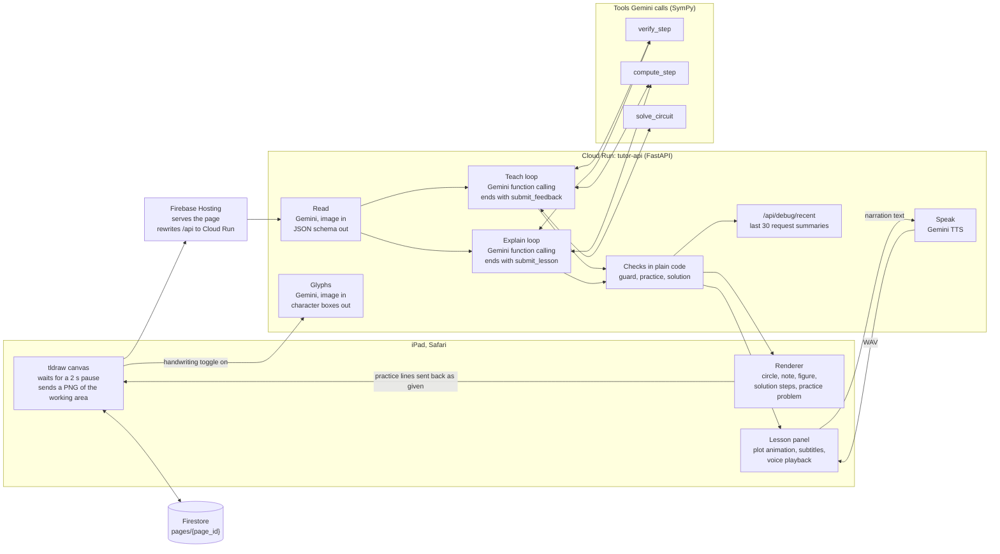

# [need: name]

Devpost page draft. Written from `AGENT_LOG.md` (to its last entry, 8:36 PM Saturday, Nov 14), `web/e2e/RESULTS.md` and the code. What is tested and how is in `docs/STATUS.md`.

Track: Best Integration of Gemini/Google API. Team: Preet and Parsh. Built at Google DevFest 2026, UC Santa Cruz, Nov 14 to 15, 2026.

Live: https://tutor-1098c.web.app

## Tagline (pick one)

1. A notebook that finds your mistake, teaches you that step, and makes you do the next one yourself.
2. A notebook that finds your mistake and makes you fix it.
3. Handwritten math on the iPad: a checked mistake, a spoken lesson, then a practice problem.

## Inspiration

We saw a project from a hackathon in Zurich [need: project name and link] where you write a calculation by hand and the app finishes it for you. It is the starting point for this project and we say that to every judge.

Finishing a handwritten line is also something Apple's Math Notes already does on the iPad, in your own handwriting, with 2D and 3D graphs. Goodnotes checks handwritten math the way a spellchecker checks text. From what we read about both (we did not test them hands-on; sources are in `docs/RESEARCH.md`), neither one teaches: no lesson, no voice, no practice problem afterwards.

Preet's comment after his second round on the iPad was that the notebook marked and hinted but did not teach. So the centre of this project is what a tutor does after pointing at the mistake:

- It circles the wrong term and asks a question. It does not write the answer.
- "Teach me" plays a spoken, animated lesson about your problem, including where your own line went off.
- The lesson ends with "Your turn": a new problem of the same kind, written on the page for you to solve by hand, and your answer is checked.
- Help is a ladder of three hints that explain. Only the third shows the worked step.
- A full worked solution appears only when you write "solve" or ask out loud.

## What it does

You open a web page on the iPad and write with the Pencil.

- **Finds mistakes.** Write `f(x) = 3x^2 + 2x`, then `f'(x) = 6x + 1`, and pause for 2 seconds. A red circle appears around `+ 1` with a question beside the line, for example "What is the derivative of 2x?". Fix the line and the mark goes away. The same mistake is not flagged twice.
- **Teach me.** A panel docks beside your work (right side in landscape, bottom in portrait) and plays 6 to 9 steps: a moving plot, the math written line by line, subtitles, and a Gemini text-to-speech voice reading the narration. The notebook stays visible and keeps its zoom.
- **Your turn.** When the lesson ends, the page writes a new problem of the same kind under your work, for example `g(x) = 4x^2 + 5x` and `g'(x) =`. You answer by hand. The server checks the answer with the math engine. A wrong step gets the usual red mark. A correct answer is meant to get a green note and flip the label to "Solved". As of the last log entry, the check itself runs on the live server and returns `correct`, but the "Solved" confirmation has not been seen on the live site. The fix for that is written and passes its unit tests. It was not deployed when the log ends.
- **Help that explains.** Tap Help. Hint 1 names the idea in words. Hint 2 sets the problem up. Hint 3 shows the worked step. The next hint is fetched in advance and arrives after a countdown. Hold the Help button to ask a question out loud; a bar shows the words as they are heard. Help on finished, correct work says so in a green note.
- **Full solve, on request.** Write `solve` next to an equation, or ask out loud. The worked steps are written under your work one line at a time, at your handwriting's size, with the equals signs lined up. Every step is checked by the math engine first, and a step that fails the check is not shown.
- **Graphs.** Write "graph it" under a function and a plot appears beside it. A function of x and y gets a 3D surface you can rotate.
- **Finish a line.** Write `g'(x) =` and stop. The tutor writes `12x` after the equals sign. This only happens when the line ends in `=` or you ask.
- **Feedback stays off your work.** Notes, questions and graphs are placed clear of your ink, of printed worksheet text and of the on-screen buttons.
- **Worksheets.** Import a PDF. Printed text is context. It is never marked wrong.
- **Circuits.** Draw a DC circuit with a source and resistors and write an answer such as `I = 9 mA`. The tutor solves the circuit and circles a wrong value.
- **Write in my handwriting (prototype, off by default).** With the toggle on, the tutor's inline answers and solution steps are drawn as pen strokes built from your own letter shapes.
- **Saved pages.** Each notebook page saves to Firestore. Open `?page=<id>` on another device to continue.

Limits we want to be clear about:

- Nothing built after about 6:20 PM Saturday has been run on a real iPad yet. That covers the docked lesson panel, the Gemini voice, "Your turn", full solve, the new Help, and the handwriting toggle. They were tested in a headless browser, most of them with real pen events against the real server.
- Marks are checked, with one gap. A red mark on a line the checker called correct is removed by code. If the checker cannot parse a step it returns `unknown`, and the model may still mark that line when it is very sure.
- The handwriting toggle has only been verified with generated strokes, plus a measurement of character finding on 4 real pages of Preet's writing (55 of 59 characters found).

## How we built it

### Architecture

The page knows no math. It draws a fixed set of actions (`circle`, `underline`, `note`, `figure`, `ask`, `speak`, `lesson`, `solution`). The teaching rules are in plain-English prompt files (`server/prompts/*.md`). The Gemini key stays on the server.

### Where Gemini is used, by rubric item

**Multimodal input (image in)**

- `read.py`: one call per check. Input is the PNG of the student's handwriting, plus the previous reading. Gemini returns every line as LaTeX and as calculator-syntax text, with a box on the page, a relation to the line above (`derivative`, `integral`, `solve`, ...), a confidence, and whether it is handwriting or printed worksheet text. A hand-drawn circuit comes back as a netlist.
- `glyphs.py` (`POST /api/glyphs`): image in, one box per handwritten character out. This feeds the "Write in my handwriting" toggle.

**Structured output**

- Both image calls use `response_mime_type="application/json"` with a JSON schema (`response_json_schema`), so the server gets typed lines and boxes it can validate.
- The final answer of each loop is also structured. It must arrive as a `submit_feedback` or `submit_lesson` function call whose arguments match a schema of drawing actions or lesson steps. The page renders that data directly.

**Function calling**

The teach step (`teach.py`) runs a loop of up to 5 rounds with function calling mode `ANY`, so Gemini must call a tool every turn. The tools:

| Tool | What it does | Backed by |
| --- | --- | --- |
| `verify_step(before, after, relation)` | Says whether a line follows from the line before it: `correct`, `incorrect` or `unknown` | SymPy (`verify.py`): symbolic check, then random numeric spot checks; derivatives, integrals, solution sets |
| `compute_step(before, relation)` | Works out the next line, for an open line, a requested solution or a practice problem | SymPy (`compute.py`) |
| `solve_circuit(elements, claims)` | Solves a DC circuit and checks each value the student wrote | SymPy modified nodal analysis (`circuits.py`) |
| `submit_feedback(actions, clear_line_ids, hint_updates)` | Ends the teach loop with the actions to draw, including a `solution` action for a full solve | Schema checked by the server |
| `submit_lesson(...)` | Ends the lesson loop with the steps, visuals, narration and the practice problem | Schema checked by the server |

Teach me (`explain.py`) runs a second loop with `verify_step`, `compute_step` and `submit_lesson`. Before the first Gemini call the server runs `compute_step` itself for the target step, and for each term of a sum, and hands the results to the model as already checked. On the real model this took a lesson from 3 rounds (7.5 to 9.4 s on four runs) to 2 rounds (5.0 to 8.5 s on four runs). Code then cleans the lesson: every plot gets a window, marks outside the plot are dropped, and a lesson with too few steps, no picture or nothing moving is sent back to Gemini with the reasons.

Plain code runs after the model, the same for every subject:

- `guard.py`: a red circle on a line the checker called correct is dropped. Printed worksheet text is never marked. An unfinished line is never marked. A finished answer is only written on a line that ends in `=` or after a request. A flagged line that has not changed gets nothing new.
- `guard.py` also writes when the model stays silent. If the checker called a line incorrect and nothing is going out for it, the server adds a red circle and "Check this step again. What changed from the line above?". A written "solve" that produced no usable steps gets one blue note saying so.
- `solution.py`: the chain of solution steps is checked with `verify.py` before anything is sent.
- `practice.py`: a practice problem must parse, differ from the student's problem and be solvable by `compute_step`, or it is retried once and then dropped. The lines the tutor wrote come back in the next request as `given` lines, and the student's answer is verified against them by the server before the model runs.

**Text to speech**

- `speak.py` (`POST /api/speak`): Gemini TTS (`gemini-3.8-flash-lite-tts`) turns each lesson step's narration into a WAV. The page requests all steps and plays them with subtitles. The server allows 3 voice calls at a time and retries once after 1 second on a rate-limit error. If a clip fails or is late, the page falls back to the browser's built-in voice.

**Several Google services together**

- **Gemini API**: read, teach, explain, glyphs and speech. Main model `gemini-3.5-flash`.
- **Cloud Run**: the FastAPI server (`tutor-api`, us-central1) with the pipeline and the SymPy tools.
- **Firebase Hosting**: serves the page and rewrites `/api/**` to Cloud Run, so the browser is same-origin and never sees the key.
- **Firestore**: saves each notebook page (ink, feedback and hint levels) under `pages/{page_id}`.

Voice questions use the browser's speech recognition in Safari. That part is not a Google API.

### The rest of the stack

- Web: Vite, React, TypeScript, tldraw for the canvas, KaTeX for math text, function-plot and mathjs for graphs, Three.js for 3D surfaces, pdf.js for worksheets.
- Server: Python, FastAPI, Pydantic, the `google-genai` SDK, SymPy.
- A shared contract (`contract/contract.ts`, mirrored in `server/models.py`) defines every request, reply and action.
- Tests at the last log entry: 298 offline server tests (pytest) and 407 web tests (Vitest).
- `server/e2e.py` posts generated handwriting-style images to the deployed API. It is run on every Cloud Run candidate before traffic is moved to it.
- `web/e2e/run.mjs` is the end-to-end harness. It opens the page in headless Chrome at iPad size and writes every line on the real canvas with pen pointer events, then lets the page capture, call the real server and draw the reply. No reply is faked. `GET /api/debug/recent` shows what the deployed server read, which tools the model called and what was sent, for the last 30 requests.
- The code was written by two AI coding agents, one on each of our laptops, coordinating through a shared log file. We directed the work and tested on the iPad.

### Measured timings

From `web/e2e/RESULTS.md`: pen strokes on the canvas, the deployed server, `gemini-3.5-flash`. Request time only; the page also waits 2 seconds after the last stroke before sending.

- Wrong derivative check: 6.8 s (portrait) and 4.7 s (landscape). Algebra mistake: 4.7 s. Correct work: 5.1 s.
- Finish a line: 3.9 to 6.1 s over four runs.
- Full solve: 8.5 s and 7.3 s.
- First hint: 4.6 s and 4.2 s after the tap. Hints 2 and 3 follow about 18 s apart by design; one third hint took 24.8 s.
- Teach me: the lesson came back in 8.6 to 11.3 s. Each of the 7 voice clips took 2.0 to 4.7 s.
- Graph: 5.3 s and 7.1 s from the last stroke, pause included. 3D surface: 5.7 s.
- Character finding for the handwriting toggle: 3.2 s and 4.9 s.

## Challenges we ran into

- **A server change went live before the page that needed it.** The server started sending a `practice` field with every lesson at about 7:31 PM. The page that was live at that moment validated lesson data strictly and rejected the new field, so Teach me did not open on the live site until Hosting was redeployed at 7:33:35 PM. Our rule since then: when a server change adds a field the page has to accept, Hosting is deployed first, then Cloud Run.
- **Handwriting mistaken for printed text.** In the end-to-end run, Gemini labelled handwriting as `printed` on 2 of 28 pages with no worksheet on them. Our own rule that printed text is never marked then removed the answer, and the student saw nothing. The server log showed the right answer had been computed and dropped. The page now tells the server whether a worksheet is in the picture (`has_worksheet`), and when it is not, every line is treated as handwriting.
- **The practice answer is written on the same row as the prompt.** The page writes `g'(x) =` and the student writes the answer after the equals sign. The server only counted handwriting below a tutor-written line as work on that problem, so a correct answer was verified as `correct` and then nothing was sent back. The statement and the ask line were also treated as two separate problems. The fix joins them into one problem and counts ink on the ask row as the answer. It passes its unit tests, including the exact failing request, and was waiting for a deploy when the log ends.
- **The model sometimes says nothing.** In one run the checker returned `correct` for a practice answer and the model submitted no actions. Confirmations and the first mistake mark now come from code when the checker's verdict is known and the model is silent.
- **Landscape lessons shrank the page.** Opening a lesson in landscape zoomed the notebook to 58% and put the first line under a toolbar button. Opening a lesson no longer changes the zoom. The page measures where the controls are and slides only if the problem's lines are covered.
- **Voice rate limits.** Requesting every step's narration at once got two `429` errors from the TTS model, and those steps fell back to the browser voice mid-lesson. The server now runs 3 voice calls at a time with one retry.
- **The spend cap.** At 8:35 PM the project hit its monthly Gemini spend cap and every Gemini call on the live site returned an error until the cap is raised. The end-to-end runs alone had made 70 check calls.
- **The capture window dropped the line above.** On the live site a wrong derivative got no red circle on Preet's iPad. Cloud Run logs showed each of those checks had read one line, so the checker had nothing to compare it with. Generated test images always contained both lines, which is why the server tests never saw it. The window now also takes the nearest line directly above.
- **Free-tier quota and the canvas licence.** The first key allowed 5 requests per minute per model, and one check is 2 to 3 requests. tldraw hides its interface on an https production host without a licence key, so the first deploy was a blank page. We made a key in the billed project and requested a trial licence key. We did not bypass the check.
- **A deploy that returned errors for two minutes.** One Cloud Run rollout served 500s although the new revision was healthy. We now deploy with no traffic, test the candidate privately, then promote.

## Accomplishments that we're proud of

- The teaching loop runs end to end with pen strokes on the real canvas against the deployed server: a wrong derivative is circled, Teach me opens a 7-step lesson with all 7 Gemini voice clips returned and played, a practice problem is written under the work, and the handwritten answer is sent back and verified as `correct` by the math engine. The last piece, showing "Solved", is the one not yet confirmed live.
- A lesson is generated from the student's own wrong line. For `f'(x) = 3x^2 - 3x` the lesson's seventh step says: "In your line, you wrote three x squared minus three x, keeping the x on the second term."
- The tutor never sets a practice problem it cannot check. `compute_step` has to solve it before it is shown.
- In the end-to-end run Gemini read every one of about 60 pen-drawn lines on 28 pages with the right text, including exponents, primes and `d/dx (x sin x)`. Those lines were drawn from a stroke font, which is neater than real handwriting.
- The end-to-end harness found three bugs and several smaller problems in one evening that 390 web tests and the API-level script had not. All three bugs have fixes, re-run and passing on the dev page.
- Earlier in the day the core check worked on a real iPad with Preet's handwriting (through the laptop's dev server), and the public link loaded on venue wifi with voice input working.
- No topic-specific code in the page or the guard. Calculus, algebra and circuits use the same actions and the same rules. A new subject is a new tool and a prompt section.

## What we learned

- Test with what the user will send. Generated images passed while real Pencil pages failed, because the bug was in which part of the page got sent. Driving the real canvas with pen events found problems that posting images to the API could not.
- Let the model decide what to say, and let code decide what is allowed to reach the page. When the checker already knows the verdict, code should also be able to speak if the model does not.
- Forcing a function call every turn makes the model's work inspectable. Every reply carries the list of tool calls and their verdicts, and the status line on the page now says why nothing was drawn.
- Deploy the side that tolerates the other first.
- Model choice matters per task. The lite model repeated hints, needed lessons sent back for having nothing moving, and found 27 of 32 characters where `gemini-3.5-flash` found 55 of 59.
- Log what the deployed server saw. The missing-circle bug and the missing "Solved" were both found from `/api/debug/recent` and the request logs.

## What's next

- Confirm "Solved" on the live site, then run every flow on the iPad with real handwriting. Nothing built after 6:20 PM Saturday has had that yet.
- A practice ladder: after a miss, the next problem arrives with its first step written in.
- Remember mistake patterns across a session and aim practice at the most frequent one.
- Faster lessons: stream step 1 while later steps are written, or prepare the lesson as soon as a mistake is marked.
- Finish "Write in my handwriting" with real Pencil testing.
- Accounts and access rules for saved pages, and remove the open debug address. Today a page is protected only by its id.
- More engineering tools beside `solve_circuit`, such as AC circuits and block diagrams.

## Built with

- Gemini API (`gemini-3.5-flash` for reading, tutoring, lessons and character finding; `gemini-3.8-flash-lite-tts` for speech), `google-genai` Python SDK
- Google Cloud Run
- Firebase Hosting
- Cloud Firestore
- Python, FastAPI, Pydantic, SymPy
- TypeScript, React, Vite
- tldraw
- KaTeX, function-plot, mathjs, Three.js, pdf.js
- pytest, Vitest, headless Chrome (puppeteer-core)
